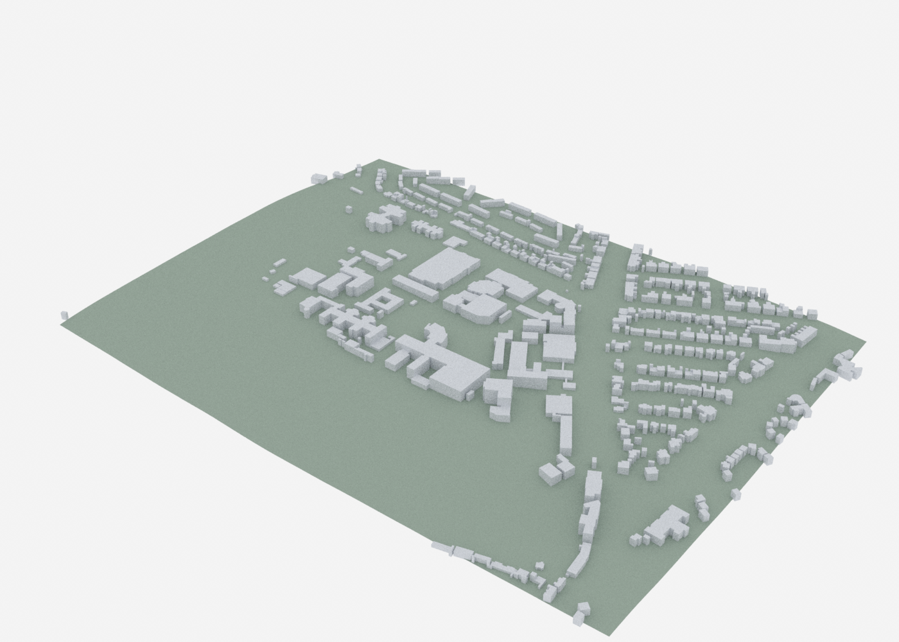
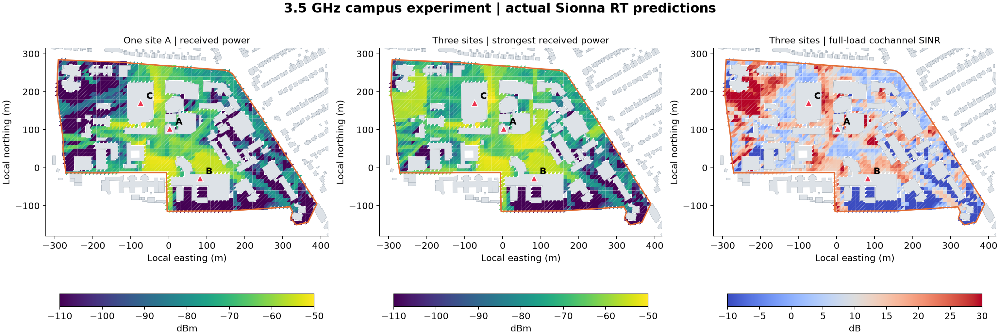

# Edinburgh Sionna Radio Maps

A reproducible radio-propagation study of the University of Edinburgh's King's Buildings campus using **Sionna RT 2.2.0**. The project combines OpenStreetMap building geometry, terrain elevations and three rooftop transmitter scenarios to examine received power, interference and coverage at **2.4, 3.5 and 5.8 GHz**.



## Explore the study

- **[Technical report (PDF)](report.pdf)** — methods, results, numerical checks and research extensions.
- **[Report (Markdown)](report.md)** — readable directly on GitHub.
- **[Interactive explorer](explorer.html)** — download the repository and open this file in a browser. Rotate the campus, inspect buildings, switch frequencies and compare transmitter configurations.
- **[Reproduction guide](docs/reproduction.md)** — environment setup and experiment commands.
- **[Data and model reference](docs/data.md)** — coordinates, geometry, assumptions and result-array definitions.
- **[NVIDIA pipeline integration](docs/nvidia-integration.md)** — export conventions and upstream execution.

The explorer includes its data and runs offline. GitHub displays its source; open the downloaded file locally to use the interactive controls.

## Results

Coverage is the percentage of the modeled outdoor campus surface meeting the stated target. Each active transmitter uses 30 dBm; sites share one fully loaded channel.

| Frequency | A only: RSS ≥ -85 dBm | A + B + C: RSS ≥ -85 dBm | A + B + C: RSS ≥ -85 dBm and SINR ≥ 5 dB |
|---|---:|---:|---:|
| 2.4 GHz | 62.6% | 82.1% | 64.3% |
| 3.5 GHz | 54.4% | 77.4% | 61.6% |
| 5.8 GHz | 48.2% | 72.7% | 57.6% |

At 3.5 GHz, three sites increase received-power coverage by **23.0 percentage points**. The joint signal-and-interference target reaches **61.6%**, highlighting the role of channel coordination and antenna design.



Values come from [the saved summary](results/summary.csv), with per-site path gains and cell-level exports in `results/`. Doubling the sample count at 3.5 GHz changes received-power coverage from **77.41% to 77.88%**; [validation results](results/validation.json) record the numerical checks.

## Campus model

The study scores the **18.93-hectare mapped campus polygon** within a **990 × 750 m** surrounding scene. It contains **855 building parts**, including **66 inside the scoring boundary**. The three hypothetical sites are on Murray Library, James Clerk Maxwell Building and Joseph Black Building.

The scene uses OSM footprints, source-tagged or estimated building heights, flat roofs and terrain elevations. Antennas sit 3 m above modeled roofs. Propagation includes line of sight and specular reflections to depth 3, with a receiver surface 1.5 m above terrain. These settings define a reproducible simulation experiment; [the model reference](docs/data.md) gives the full assumptions and metric definitions.

## Quick start

To view the completed study, download the repository and open `explorer.html` or `report.pdf`.

To reproduce the computations, use Python 3.12 with a compatible NVIDIA GPU or LLVM CPU backend:

```bash
git clone https://github.com/MAbuain17/edinburgh-sionna-radio-maps.git
cd edinburgh-sionna-radio-maps
python -m venv .venv
source .venv/bin/activate
python -m pip install -r requirements.txt
python build_scene.py
python run_study.py --samples 20000000 --seeds 17 29
```

Windows activation, backend configuration and the complete sequence are in [the reproduction guide](docs/reproduction.md).

## Repository contents

| Path | Contents |
|---|---|
| `scene/` | Sionna/Mitsuba XML, PLY building and terrain meshes, OBJ campus model |
| `data/` | Geographic snapshot, terrain tiles, campus boundary, building features, transmitter positions and provenance |
| `results/` | Linear path gains, seed results, per-cell CSVs, summaries and validation |
| `figures/` | Rendered campus, radio maps and received-power distribution |
| `lrm_export/` | Scene and transmitter export for NVIDIA's large-radio-maps conventions |
| `docs/` | Reproduction, data definitions and integration guidance |
| `*.py` | Scene construction, simulation, analysis, rendering, reporting and validation |

## Sources and license

Study code is available under the [MIT license](LICENSE). Geographic data retain their source licenses and attribution; see [NOTICE.md](NOTICE.md).

The project builds on [Sionna RT](https://github.com/NVlabs/sionna-rt) and the geographic workflow in [NVIDIA's sionna-large-radio-maps](https://github.com/NVlabs/sionna-large-radio-maps). Campus context is provided by the [University of Edinburgh](https://science-engineering.ed.ac.uk/about/location-map). Source records and checksums are included with the data.
