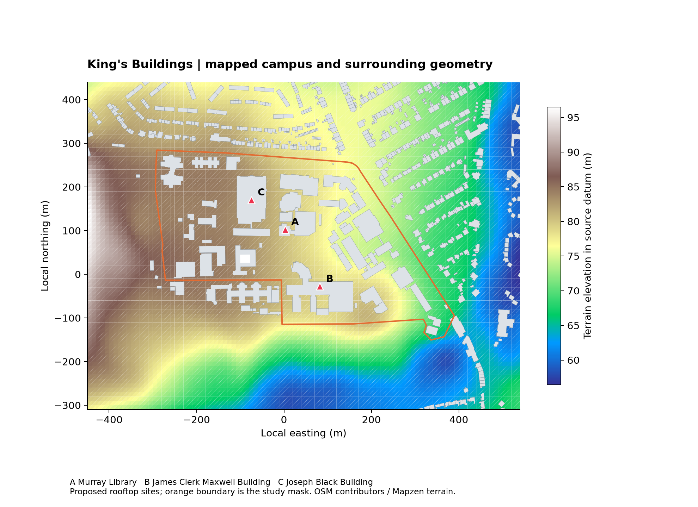
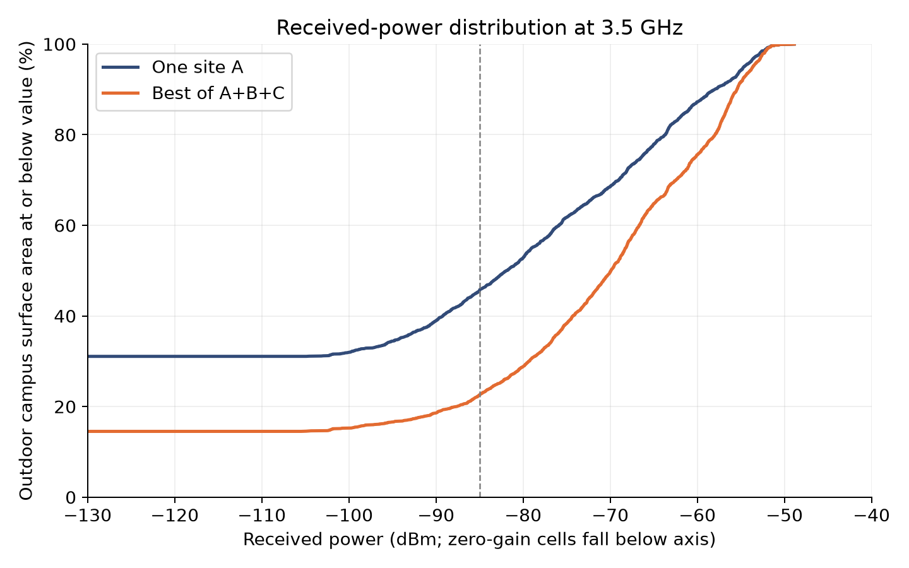

# Edinburgh King's Buildings radio study

Campus geometry, outdoor propagation and reproducible Sionna experiments | 04 October 2026

A three-site rooftop scenario increases outdoor signal coverage while introducing cochannel interference. At 3.5 GHz, the modeled area above -85 dBm rises from **54.4% to 77.4%**; **61.6%** meets both the signal target and a 5 dB SINR target. The study evaluates these configurations with Sionna RT 2.2.0 using the geometry, antenna and propagation settings documented below.

The orange line defines the 18.93 ha OSM campus polygon used for scoring; letters mark hypothetical rooftop transmitters. The surrounding rectangle provides terrain and building context. The university describes a wider 35 ha estate [2].

Deliverables include an offline interactive explorer, Mitsuba XML and PLY meshes, an OBJ model, geographic features, raw per-site gains, cell-level tables, figures, validation results, and all study code. The goal is a useful starting point for campus wireless research and field calibration.

# What Sionna and the large map project do

Sionna RT traces electromagnetic propagation through a triangle-mesh scene. Geometry determines visibility and interactions; material properties and antennas determine how power is transported. A radio map averages path gain over surface cells, producing predictions for the specified scene and radio configuration [3,4].

NVIDIA's large-radio-maps project adds geographic orchestration around Sionna RT [1]. It subdivides a region according to transmitter density, builds terrain and building scenes, selects nearby stations, and computes each tile. Tile outputs can be scheduled across a SLURM GPU cluster. The campus is small enough for one buffered scene, so adaptive subdivision would add complexity without a demonstrated benefit here.

| Component | Upstream source behavior | This campus experiment |
| --- | --- | --- |
| Scene construction | OSM buildings, terrain tiles, adaptive terrain meshes and buffers | OSM ways and multipolygons, terrain tiles, regular 10 m terrain mesh |
| Coordinates | UTM with tile southwest origin; terrain elevation retained | UTM 30N minus a documented local origin and elevation reference |
| Station placement | CSV plus optional raycast elevation and rooftop/ground offsets | Three named-roof representative points; antenna 3 m above modeled roof |
| Radio maps | Mesh measurement surface; memory-aware passes; maximum site gain | Same terrain-surface concept; retain every site gain for RSS, SINR and association |
| Runtime | Source pins Sionna RT 1.2.1; GPU memory estimator and SLURM examples | Sionna RT 2.2.0; actual LLVM CPU runs |

## Integration findings from source inspection

The README describes a height column, but BaseStationDB.from_file requires elevation. Rooftop elevations receive a further 2 m offset, and non-rooftop locations default to a 25 m offset. A site's reported altitude must therefore be interpreted before import. The code also applies a deterministic index-seeded random azimuth; this is reproducible but does not establish a real antenna orientation.

The default upstream antenna is a 2-by-16 TR38901 array and its map computation keeps the maximum linear path gain over sites. Interference analysis requires the individual site gains, so this study preserves the full site-by-triangle tensor. The campus experiment uses its own Sionna RT 2.2.0 runner; the upstream 1.2.1 export and execution conventions are covered in the integration section.

# Geographic definition and model evidence

King's Buildings offers a named science and engineering campus, published university maps, and identifiable buildings [2,5]. The study mask is OSM way 9514792 [6]. Its polygon is used as a reproducible mapped extent, not a legally verified estate boundary.

| Quantity | Value |
| --- | --- |
| Scored campus polygon | 189,297 m2 / 18.93 ha |
| Ground rectangle | 990 m east-west x 750 m north-south |
| SW corner, latitude longitude | 55.91920421, -3.18218766 |
| NE corner, latitude longitude | 55.92596538, -3.16637605 |
| Local coordinate origin | 55.922000 N, -3.175000 E; EPSG:32630 |
| Local UTM origin, metres | E 489063.667, N 6197412.288 |
| Vertical subtraction from source terrain | 80.738 m; source datum not independently surveyed |
| Building parts / campus building parts | 855 / 66 |
| Building / measurement triangles | 19,044 / 14,850 |
| Outdoor campus triangles scored | 2,584; centroid mask, surface-area weighting |

OSM was retrieved with a database timestamp of 2026-10-04 21:52:50 UTC. Complete way rings and multipolygon courtyards are assembled before triangulation. Roof triangle areas are checked against footprint areas. Outlines are extruded with flat roofs; foundations extend 0.5 m below the minimum sampled ground elevation, and roofs sit one modeled building height above the highest sampled footprint ground point.

Of the 66 campus building parts, only **5 have explicit height tags**; 44 use mapped storey counts multiplied by an assumed 3.5 m per storey, and 17 default to 10.5 m. Across the full surroundings, 535 of 855 parts use the fallback. Even explicit OSM heights are not independently surveyed. Exact roof shape, facade segmentation, windows and rooftop equipment are absent.

Terrain comes from the public Mapzen / Tilezen elevation tiles [7,8], decoded from Terrarium RGB and interpolated onto the mesh. The 10 m mesh spacing is computational resolution, not evidence that the source terrain is accurate to 10 m or that its vertical datum matches a local survey. Trees, vehicles, interior layouts and building parts tagged only as building:part are not modeled.

# Experiment specification and metrics

| Site | Proposed building | Latitude | Longitude | Local z m |
| --- | --- | --- | --- | --- |
| A | Noreen and Kenneth Murray Library | 55.922922 | -3.174965 | 17.11 |
| B | James Clerk Maxwell Building | 55.921754 | -3.173688 | 20.49 |
| C | Joseph Black Building | 55.923531 | -3.176195 | 16.52 |

Each site is a hypothetical point 3 m above its modeled roof, chosen by an interior representative point of the footprint. The positions are not evidence of installed equipment or approved mounting locations. Relative z is measured from the documented vertical reference, not directly above local ground.

| Parameter | Chosen setting |
| --- | --- |
| Frequencies | 2.4, 3.5 and 5.8 GHz |
| Antenna / power | One isotropic V-polarized element; 30 dBm per site |
| Propagation | LOS and specular reflection; maximum depth 3 |
| Disabled effects | Diffuse reflection, diffraction, refraction and external interference |
| Materials | All buildings ITU concrete; all terrain ITU wet ground |
| Measurement height | Terrain mesh translated vertically by 1.5 m |
| Sampling | 20 million rays per site per run; seeds 17 and 29 |
| Noise model | 20 MHz bandwidth, 7 dB noise figure, -174 dBm/Hz |
| Scoring targets | RSS >= -85 dBm and SINR >= 5 dB |

Let g(i,t) be the linear path gain from transmitter t to terrain triangle i. Received power in mW is p(i,t) = 10^(P(t)/10) g(i,t), with P in dBm. Best-site RSS is 10 log10(max p). Noise is 10^((-174 + 10 log10(20,000,000) + 7)/10) mW, approximately -94 dBm. Full-load reuse-one SINR is best p divided by the sum of other site powers plus noise. With one active site it becomes SNR.

The scored percentage is the sum of passing terrain-triangle surface areas divided by all outdoor campus-triangle surface areas. A triangle is classified using its centroid. This is not exact polygon clipping and is coarse near walls and boundary edges. RSS is total received power, **not RSRP**; no bandwidth-to-throughput claim is made. Three active sites use three times the total transmit power of the one-site case.

The selected ITU wet-ground material model covers 1-10 GHz in the installed implementation. The three study frequencies fall within that range.

# Results and what they imply

3.5 GHz results. Grey footprints are excluded from outdoor scoring. Low or zero sampled gains are shown at the dark end of the display scale. The third panel includes cochannel interference from the two non-serving sites.

| GHz | Active layout | RSS target % | SINR target % | Both targets % |
| --- | --- | --- | --- | --- |
| 2.4 | A only | 62.6 | 65.9 | 62.6 |
| 2.4 | A + B + C | 82.1 | 65.5 | 64.3 |
| 3.5 | A only | 54.4 | 59.6 | 54.4 |
| 3.5 | A + B + C | 77.4 | 63.7 | 61.6 |
| 5.8 | A only | 48.2 | 54.4 | 48.2 |
| 5.8 | A + B + C | 72.7 | 60.4 | 57.6 |

At 3.5 GHz, adding B and C improves received-power reach by about 23 percentage points. The joint target improves by only about 7 percentage points because sites also interfere when cochannel and fully loaded. This supports testing channel coordination, directional patterns or power control before interpreting extra signal strength as an equivalent service improvement.

The identical-power comparison favors 2.4 GHz in received-power reach: three sites cover about 82.1% above the chosen RSS threshold, versus 77.4% at 3.5 GHz and 72.7% at 5.8 GHz. It does not compare actual Wi-Fi and cellular systems, regulatory power limits, antenna apertures, bandwidths, traffic scheduling, or device performance.

Large shadows remain around modeled building masses and some campus edges. About 14.5% of the outdoor surface has zero sampled gain from all three sites in the main run. Missing diffraction, material simplification and limited ray sampling can contribute to such cells. They are candidate locations for further modeling and measurements, not certified dead zones.

# Numerical checks and confidence limits

| Check at 3.5 GHz | Result |
| --- | --- |
| 20M vs 40M rays per site per seed | RSS target area 77.41% vs 77.88% |
| Absolute change in target area | 0.46 percentage points |
| Both-positive cells, absolute gain delta | Median 0.057 dB; 95th percentile 1.34 dB |
| Largest both-positive change | 21.84 dB |
| Zero/nonzero disagreement | 1.39% of outdoor surface |
| LOS-only vs depth-three reflections | 31.3% vs 77.4% above RSS target |

The main aggregate target percentage is relatively stable to this doubling of samples, but the maximum change and zero-state disagreement show that weak cells remain uncertain. Seed repeats alone are not a sufficient convergence test: deterministic ray directions and specular components can make seed changes have little effect. No confidence interval is inferred from only two seeds.

The distribution includes zero-gain cells below the plotted range. The dashed line is the study RSS threshold. These plots and the LOS ablation show that the outcome depends strongly on modeled specular paths, which makes facade-material and geometry validation particularly valuable.

Checks passed for finite mesh coordinates, terrain face orientation and area, local UTM round-trip consistency, nonnegative finite gains, and tensor-to-mesh dimensions. Roof triangulation preserved polygon area. This is computational QA; no drive test, walk test, LiDAR comparison, receiver calibration, material fitting or independent propagation-engine validation has been completed.

# Reproduction and scaling to Edinburgh

The supplied outputs can be explored immediately without running a simulator. For regeneration, use Python 3.12, install requirements.txt into an isolated environment, and follow README.md. Build the scene, run the main frequencies plus LOS and 40M checks, validate, export the LRM layout, analyze, and regenerate this report. The OSM and terrain snapshots are included so network refreshes are optional and deliberate.

The computation used Sionna RT 2.2.0 with Mitsuba 3.9.1 and the LLVM CPU backend on Windows x64, with the official LLVM 21.1.8 library. A compatible NVIDIA GPU provides an alternative backend for larger studies. The reproduction guide records dependency versions and backend setup.

## Files that preserve scientific traceability

The raw radio NPZ files retain linear path_gain[site, triangle] and seed_gains[seed, site, triangle], plus frequency, sample count and seeds. Measurement vertices, face indices, centroids, areas and the outdoor mask are stored separately. The per-cell CSVs expose all three gains, strongest RSS and full-load SINR; zero-gain dB fields are blank. The figure and report builders recompute summaries from these files.

Source data checksums and OSM timestamps are recorded under data/. Geographic feature files use WGS84; the explicitly named local file uses metric local coordinates. NOTICE.md links the geographic and software sources and records their attribution. The study code uses the MIT license; geographic inputs retain their source terms. The NVIDIA pipeline is available from its upstream repository under Apache 2.0.

## Native large-radio-maps handoff

export_lrm.py produces a numbered tile, bboxes.npz and a station CSV. Horizontal coordinates are shifted to the tile southwest corner and the vertical reference is restored. CSV elevation is the desired absolute antenna z minus the native 2 m rooftop offset. The native README's height/elevation naming inconsistency is documented rather than silently propagated.

The upstream pipeline pins Sionna RT 1.2.1 and uses GPU-memory estimation, different antennas, and max-over-sites output. Run it in a separate environment and verify frequency, offsets and solver flags before comparing results. The export geometry and schema were prepared, but the upstream 1.2.1 pipeline and cluster launch were not executed in this study.

To scale beyond the campus, use source-backed transmitter data and the upstream adaptive tiling workflow, retain geometry buffers across tile edges, and preserve per-site gains if interference is an objective. Validate overlaps with an untiled reference area before trusting stitched maps. GPU jobs, memory-aware passes and resumable work queues become useful only as scene size and station count grow.

# Research plan and source register

## A practical next experiment

Begin with a campus walk test across open paths, courtyards and shadow edges. Record receiver height, antenna, frequency, bandwidth, transmit power, location accuracy and repeated readings. Reserve routes for evaluation rather than fitting every observation. Compare median error and error spread by LOS/NLOS condition; calibrate one model parameter group at a time.

Prioritize height verification for the 17 campus parts with assumed heights, then inspect the three candidate roofs and major obstruction edges. Replace the uniform facade and wet-ground assumptions with surveyed material groups and land cover. Add diffraction as a controlled ablation, and repeat the mesh at finer resolution. A 150 m buffer is a deliberate finite-domain choice, not a demonstrated convergence radius; repeat at 300 m or more before a deployment recommendation.

A creative research direction is a campus connectivity trail: evaluate signal, interference and site changes along pedestrian routes, then choose sites to maximize the worst-decile route quality under a fixed total-power budget. Compare cochannel, coordinated and directional scenarios. Keep accessibility, maintenance access and permissions as real-world constraints to resolve with the university, rather than inferring them from map geometry.

## Sources and attribution

[1] NVIDIA sionna-large-radio-maps source and README: <link href="https://github.com/NVlabs/sionna-large-radio-maps" color="#166187">https://github.com/NVlabs/sionna-large-radio-maps</link>

[2] University of Edinburgh campus location and wider site description: <link href="https://science-engineering.ed.ac.uk/about/location-map" color="#166187">https://science-engineering.ed.ac.uk/about/location-map</link>

[3] Sionna RT radio-map solver documentation: <link href="https://nvlabs.github.io/sionna/rt/api/radio_map_solvers.html" color="#166187">https://nvlabs.github.io/sionna/rt/api/radio_map_solvers.html</link>

[4] Sionna RT radio-map definitions and metrics: <link href="https://nvlabs.github.io/sionna/rt/api/radio_maps.html" color="#166187">https://nvlabs.github.io/sionna/rt/api/radio_maps.html</link>

[5] University campus maps: <link href="https://www.ed.ac.uk/maps" color="#166187">https://www.ed.ac.uk/maps</link>

[6] OSM mapped campus boundary: <link href="https://www.openstreetmap.org/way/9514792" color="#166187">https://www.openstreetmap.org/way/9514792</link>

[7] AWS Terrain Tiles dataset register: <link href="https://registry.opendata.aws/terrain-tiles/" color="#166187">https://registry.opendata.aws/terrain-tiles/</link>

[8] Tilezen terrain source attribution: <link href="https://github.com/tilezen/joerd/blob/master/docs/attribution.md" color="#166187">https://github.com/tilezen/joerd/blob/master/docs/attribution.md</link>

[9] OpenStreetMap copyright and ODbL attribution: <link href="https://www.openstreetmap.org/copyright" color="#166187">https://www.openstreetmap.org/copyright</link>

© OpenStreetMap contributors. Terrain data retain their underlying source attributions; NVIDIA code retains Apache 2.0. The experiment uses hypothetical transmitter sites and modeled building properties. Campus measurements provide the next step for calibration and evaluation.